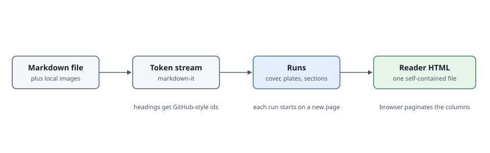
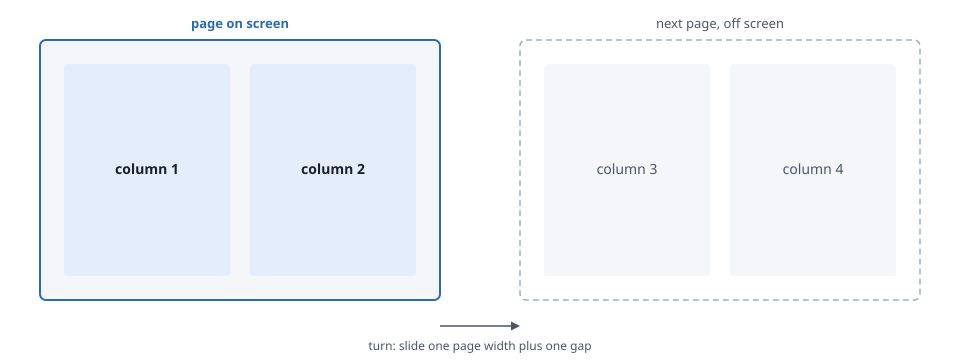

# md-reader: How Your Markdown Becomes a Book

## Contents

[Structure](#part-1-structure) | [Pages](#part-2-pages) | [Figures](#part-3-figures) | [Cards and code](#part-4-cards-and-code) | [Reading](#part-5-reading) | [Glossary](#glossary)

md-reader turns one long Markdown file into a single HTML page that reads like a book. Each screen shows one page, each page has two columns, and you turn pages sideways instead of scrolling. On a phone the page drops to one column.

This document describes the conventions md-reader follows. It is also its own example: build it with `pnpm example` and open `examples/conventions.html` to see every convention at work.



## Part 1: Structure

md-reader reads the outline of your document from its headings. You do not add any markup of your own.

### The title and the cover

The first level 1 heading becomes the title on the cover and in the browser tab. When it contains a colon, the part before the colon is the title and the part after it becomes the small line above the title. `# md-reader: How Your Markdown Becomes a Book` gives the title "md-reader" and the line "How Your Markdown Becomes a Book". Pass `--title` to override it.

Everything between the title and the first level 2 heading is the front matter. It goes on the cover, next to a generated table of contents with page numbers.

### A hand-written contents list is dropped

Many documents carry a hand-written contents list under a `## Contents` heading. md-reader drops that heading and the list of links that follows it, because the cover and the Contents drawer already list every section with its page number. Any paragraphs after the list stay and become part of the front matter.

### Sections

Every level 2 heading starts a section, and every section starts on a new page. Level 3 and level 4 headings stay inside the flow of the section and appear as sub-entries in the Contents drawer.

When a heading follows the pattern `Part 3: The five steps`, md-reader splits it. "Part 3" becomes the small label above the section title, and "The five steps" becomes the title. The words Part, Chapter, Section, Step, Lesson and Unit are recognised, with Arabic or Roman numerals. The cover then counts the numbered sections, for example "5 parts".

### Heading ids

Headings get the same ids GitHub and Gitea give them, so a link like `[the loop](#part-4-the-loop)` keeps working. Clicking it turns to the page where that heading starts.

## Part 2: Pages

The browser does the pagination. Each section is laid out in CSS columns with a fixed height, and the columns that do not fit overflow to the right. md-reader measures where the last column ends, rounds up to whole pages, and slides the strip of pages sideways when you turn a page.

### What stays together

- Headings stay with the paragraph that follows them.
- Code blocks, tables and glossary entries never split across two columns. A code block taller than a column scrolls inside its own box instead.
- Paragraphs keep at least two lines at the bottom and top of a column.

### Text size and window size

Changing the text size or resizing the window lays the pages out again. md-reader remembers the first block on the current page and turns back to it afterwards, so you keep your place. The text size and your place are stored in the browser, per document.

## Part 3: Figures

A paragraph that holds nothing but an image becomes a numbered figure. Where the figure sits decides how big it is.



- **In the front matter**, the figure gets a page of its own right after the cover.
- **At the start of a section**, directly after the heading or after its first paragraph, the figure shares an opening page with the section title, as in this section.
- **Anywhere else**, the figure sits in the column at column width.

Every figure has an Enlarge button that opens it full screen.

### Captions

The caption is the image title, the text in quotes after the file name: ``. Without a title, md-reader uses the alt text up to its first colon or full stop. The full alt text stays on the image for screen readers.

### SVG files are inlined and themed

Local SVG files are copied into the page, so the HTML has no outside files. Every fixed colour in the SVG is replaced by a CSS variable. In dark mode those variables get a matching dark colour with the same hue, and white backgrounds take the colour of the page. PNG, JPEG, GIF, WebP and AVIF files are embedded as they are.

Images from other websites are left as links, and md-reader prints a warning for each. Some hosts block them; claude.ai artifacts are one.

## Part 4: Cards and code

### Cards

A paragraph that is only bold text, directly followed by a blockquote, becomes a card with a Copy button. The bold text is the card's heading. Text before a colon becomes its label. This suits prompts, commands and templates that readers copy.

**Prompt: summarise a section**

> Read the section of [document] that starts at the heading [heading]. Write a summary of at most five sentences for [audience]. Keep every number exactly as it is written. Do not add advice the section does not give.

Text in square brackets inside a card is highlighted as a slot for the reader to fill in.

A blockquote without a bold label stays a plain quotation:

> Prefer one long, well-structured document over a dozen short ones. md-reader makes the long one readable.

### Code

Fenced code blocks get a label with their language and a Copy button. Markdown and YAML blocks wrap long lines. All other languages keep their lines intact and scroll sideways, so indentation and alignment survive.

```yaml
title: Release checklist
owner: platform-team
steps:
  - Tag the release candidate and let the pipeline publish the image to the registry.
  - Run the smoke tests against staging.
```

```text
md-reader/
  src/cli.js          argument parsing, reads the file, writes the page
  src/build.js        Markdown to runs: cover, plates and sections
  src/svg.js          SVG inlining and dark-theme colours
  src/template.html   styles and the reader script
```

### Tables

Tables keep their rows on one column. A table wider or taller than a column scrolls inside its box and gets an Expand button.

| Input | Becomes | Notes |
| --- | --- | --- |
| `# Title: Subtitle` | Cover title and the line above it | Override with `--title` |
| `## Part 2: Pages` | A section on a new page, labelled Part 2 | Plain `## Pages` works too |
| `` alone in a paragraph | A numbered figure | SVG is inlined and themed |
| `**Label: heading**` then `> text` | A card with a Copy button | Brackets mark slots |
| A two-column table under `## Glossary` | A list of terms | Entries never split |

## Part 5: Reading

| Action | Keys and gestures |
| --- | --- |
| Next page | Right arrow, Down arrow, Page Down, Space, scroll down, swipe left |
| Previous page | Left arrow, Up arrow, Page Up, Shift and Space, scroll up, swipe right |
| First and last page | Home and End |
| Jump to a section | Contents button, the contents on the cover, or a segment of the progress bar |
| Close a panel | Escape |

The bar at the top shows the section you are in. The bar at the bottom has one segment per section, sized by its number of pages, and fills up as you read.

The address bar ends with the id of the heading you are reading, so a copied link opens at that section. When you open the page again without a heading in the link, it returns to where you stopped.

## Glossary

| Term | Meaning |
| --- | --- |
| Run | A stretch of content that starts on a new page: the cover, a figure page or a section. |
| Plate | A page that holds one figure at full size, sometimes with the section title above it. |
| Front matter | Everything between the title and the first level 2 heading. It goes on the cover. |
| Card | A bold label followed by a blockquote, shown with a Copy button. |
| Slot | Text in square brackets inside a card, highlighted as a placeholder. |
| Fragment | Output without the document head, for hosts such as claude.ai artifacts that add their own. |
